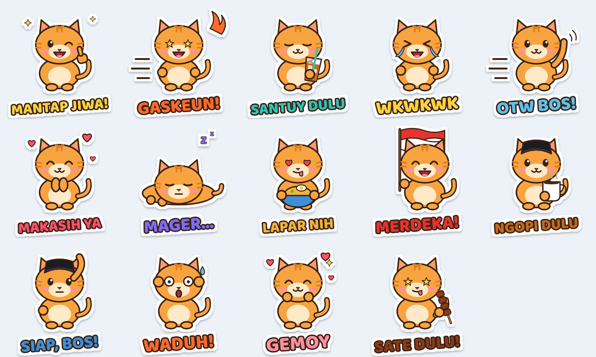

# Paket Stiker "Si Oyen" 🐱🇮🇩

Si Oyen adalah kucing oren lucu yang hobi santuy, ngopi, dan makan sate. Paket ini berisi 14 stiker dengan ungkapan sehari-hari khas Indonesia.

| No | Stiker | No | Stiker |
|----|--------|----|--------|
| 01 | Mantap Jiwa! | 08 | Lapar Nih |
| 02 | Gaskeun! | 09 | Merdeka! |
| 03 | Santuy Dulu (es teh) | 10 | Ngopi Dulu (pakai peci) |
| 04 | Wkwkwk | 11 | Siap, Bos! |
| 05 | OTW Bos! | 12 | Waduh! |
| 06 | Makasih Ya | 13 | Gemoy |
| 07 | Mager... | 14 | Sate Dulu! |

## Isi folder
- `webp/` — 512×512, latar transparan, di bawah 100 KB (format stiker WhatsApp)
- `png/` — 512×512 transparan (untuk Telegram, LINE, atau cetak)
- `svg/` — vektor, bisa diperbesar tanpa pecah
- `tray.png` — ikon paket 96×96
- `buat-stiker.js` — skrip pembuat; ubah teks/warna lalu jalankan `node stiker/buat-stiker.js`

## Cara pakai di WhatsApp
Pasang aplikasi pembuat stiker (misalnya "Sticker Maker"), buat paket baru, pakai `tray.png` sebagai ikon, lalu masukkan file dari folder `webp/`.

## Cara pakai di Telegram
Kirim file dari `png/` atau `webp/` ke @Stickers lewat perintah `/newpack`.
